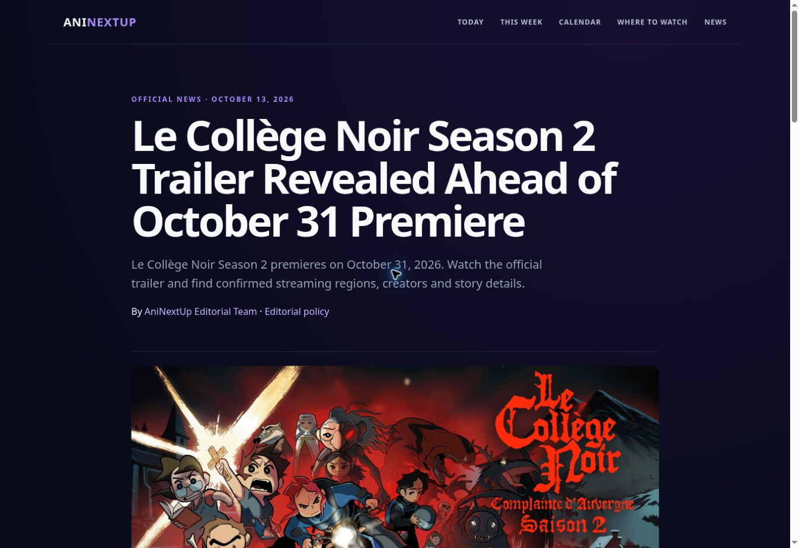
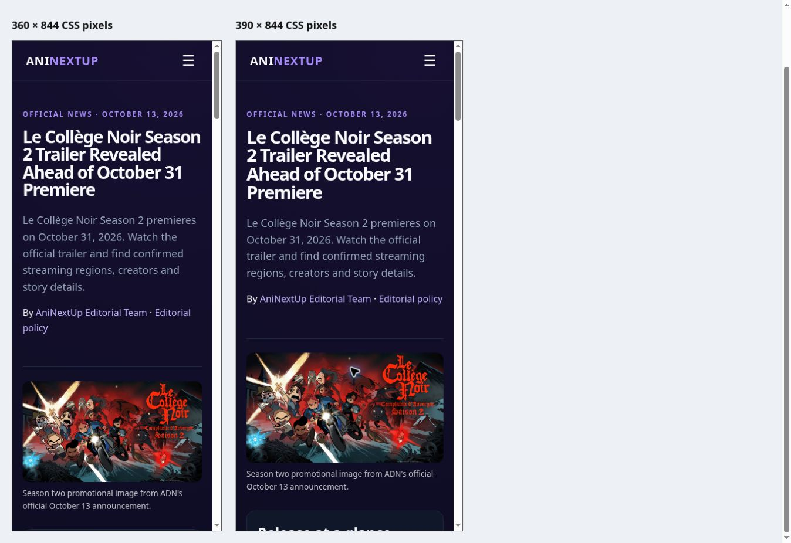
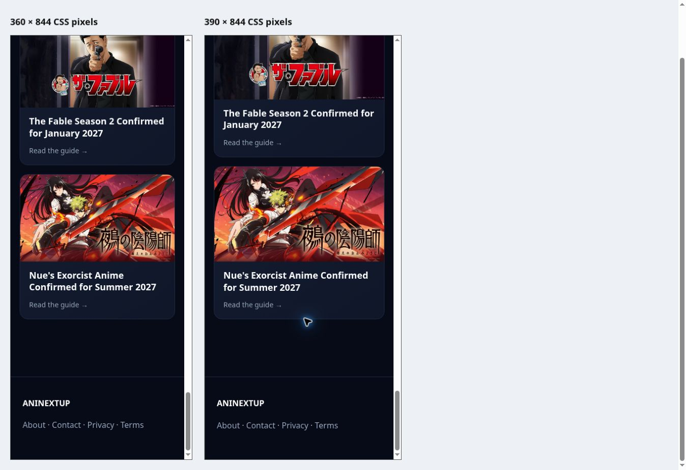
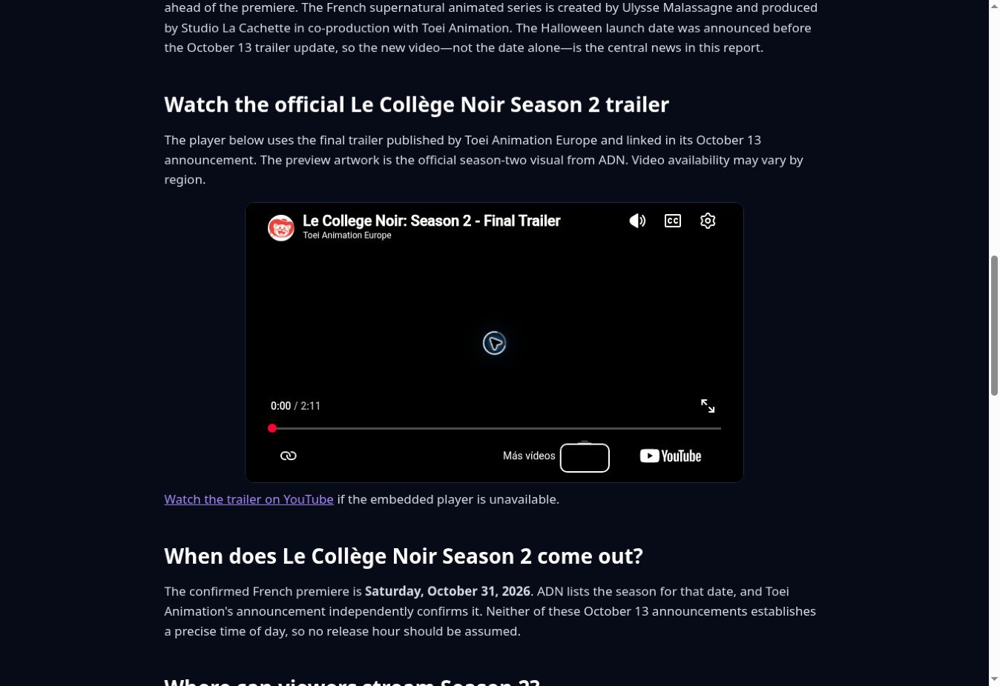

# Le Collège Noir Season 2 — preparation and real-browser QA

Tested October 13, 2026 (America/Santo_Domingo), October 14 UTC. PR #14 remains an **unpublished draft, BLOCKED_QA_PENDING**. No merge, production deployment or publication approval was performed.

## Corrections

- Matched the final trailer to Toei's official announcement: `WjbH4XnNJh4`. The previous `cH1hGkmJlXQ` is ADN's separate upload and explicitly country-blocked in this QA browser.
- Cached the authentic ADN season-two artwork at `assets/images/covers/le-college-noir-season-2-official.png`. Hero and player poster use relative same-site paths so both preview and production resolve after approval. SEO image URLs retain the production canonical host.
- Replaced the failing YouTube thumbnail request with the verified official promotional visual, explicitly identified as preview artwork in the article.
- Removed the internal image-check instruction from the reader-facing caption; added intrinsic hero dimensions, image metadata and initial menu state.
- Completed VideoObject upload date (October 13, confirmed on YouTube) and measured duration (130 seconds); shortened the SEO page title.
- Moved this editorial news entry to `guides`, made it discoverable in News, and regenerated crawlable home/news HTML. Matched the static homepage ordering to the client-side tagged-news-plus-guides selection.
- Added a noindex responsive QA fixture under `editorial/previews/le-college-noir-responsive-qa.html`. This fixture renders the real article in 360px/390px document viewports; it is not in the sitemap.

## Results

| Check | Result and evidence |
| --- | --- |
| Official cover origin | PASS: ADN official announcement embeds this season-two artwork; source response HTTP 200, image/png, 275453 bytes, 1024 × 576. Visual subject shows Le Collège Noir, Complainte d'Auvergne, Saison 2. |
| Cached cover | PASS: preview response HTTP 200 image/png, 275453 bytes. SHA-256 `96f5984ab2933921d4b3fd2edead59363fe5be08b2f4ccd30ae8cb319dc34fb2`. |
| Hero and trailer poster | PASS: same verified artwork, nonzero natural dimensions and descriptive alt text; no placeholder. |
| Related artwork | PASS: The Fable 1200 × 630, Nue's Exorcist 1920 × 1080; visually topic-matched on desktop and at 360/390 widths, no generic fallback. |
| Desktop article | PASS: real Chrome rendering at innerWidth 1363; document clientWidth/scrollWidth both 1348, no horizontal overflow. Header, H1, prose, trailer box, footer and two related cards inspected. |
| Mobile-width article | PASS: real nested document rendering at innerWidth 360 and 390, not a static mockup. clientWidth/scrollWidth 345/345 and 375/375. Hero/title/byline wrap, single-column release summary, menu opens/closes, cards stack and images load. |
| Native mobile hardware | NOT TESTED: current browser APIs expose a desktop Chrome surface without native phone/Safari/touch-device emulation. Responsive width tests do not establish iOS Safari or physical-phone behavior. |
| Home and News card | PASS: same cached 1024 × 576 image rendered in desktop and 390px documents. Article is present in static HTML and client-rendered discovery. |
| Article links | PASS: all 17 distinct href destinations returned HTTP 200, including official ADN/Toei pages, YouTube watch route and all internal routes. Related card clicks additionally verified their intended article headings in the browser. |
| SEO | PASS: English language, single H1, title/description, canonical, robots, OG/Twitter image metadata; NewsArticle, BreadcrumbList and VideoObject parse as valid JSON. This is syntax/content QA, not a guarantee of Google rich-result eligibility or indexing. |
| Sitemap | PASS: preview HTTP 200 application/xml; exactly one canonical Le Collège Noir URL, lastmod 2026-10-13. |
| Preview indexing | PASS: article, cached image and sitemap responses include X-Robots-Tag: noindex. Production content has not been changed. |
| Site JavaScript | No article-origin JavaScript exception observed in captured console logs. Browser extension metadata errors were present and are not site code errors. |
| Official trailer identity | PASS: Toei announcement embeds WjbH4XnNJh4; YouTube page title is Le College Noir: Season 2 - Final Trailer, channel Toei Animation Europe, expanded upload date October 13, 2026. |
| Player activation | PASS: click replaces poster with privacy-enhanced YouTube iframe for WjbH4XnNJh4 on desktop and at 360px width. Fallback direct YouTube link resolves. |
| Actual video playback | **NOT VERIFIED / BLOCKING**: after play, embed and direct YouTube watch both remain currentTime=0, readyState=0, paused=false with a black video surface. Metadata and controls load, media frames do not advance. No definitive cause or playback error was exposed for this Toei upload. Do not claim this is proven region blocking; only the old ADN upload explicitly reports that. |
| Local checks | PASS: `python scripts/validate_publication.py`, `node tests/test_discovery.js`, explicit JSON-LD / static discovery / unique sitemap checks. |
| CI before final QA evidence commit | Workers preview build and editorial-audit checks succeeded for the implementation commit 7818cf0; subsequent preview builds for relative artwork paths and QA fixture succeeded. |

## Gate and next verification

The article is **not LISTO PARA PUBLICAR**. Retest actual media playback in a browser that receives video frames, verifying that playback time advances and the animation appears. If physical-mobile coverage is required, test iOS Safari/Android Chrome separately. Do not merge or publish without the owner's explicit PUBLÍCALO.

The News hub also displayed pre-existing generic fallbacks on unrelated titles hosted by external image services. Those observations do not invalidate the verified Le Collège Noir card, and this report does not certify the entire website's image inventory.

## Visual evidence

